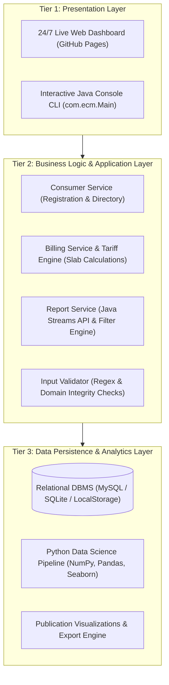
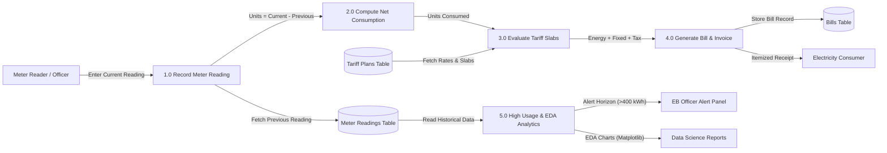
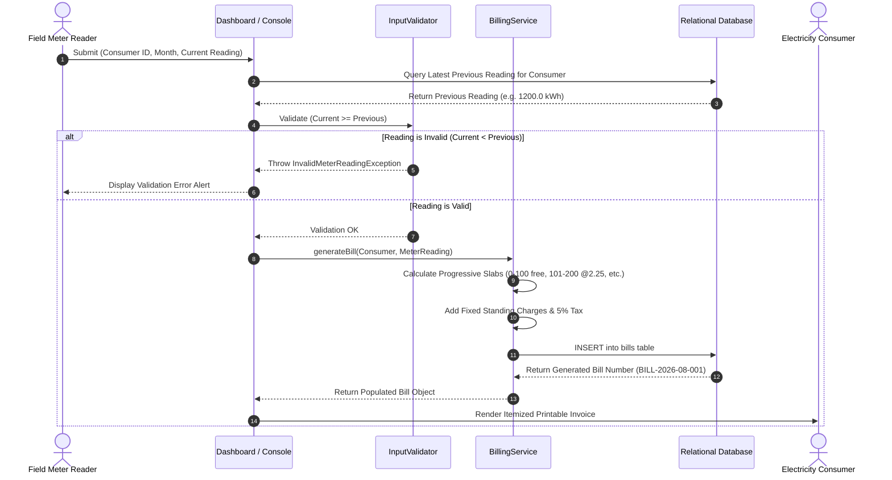

# SYSTEM ARCHITECTURE & DESIGN SPECIFICATIONS
## Scenario 14: Electricity Consumption Management and Energy Usage Analysis System

**Student:** Kanishka K | **Register No:** 732925ITR044 | **Class:** 25IT3A  
**Institution:** Velalar College of Engineering and Technology, Erode - 12  
**Course Code:** 25ITT33 – Software Engineering (Unit 3: Software Design)

---

### 1. OVERALL 3-TIER ARCHITECTURE

VoltTrack is built upon a modular 3-tier architectural design pattern that cleanly decouples presentation logic, domain business logic, and persistence/analytics infrastructure.

---

### 2. DATA FLOW DIAGRAM (DFD LEVEL 1)

---

### 3. SEQUENCE DIAGRAM: METER READING TO BILL GENERATION

---

### 4. DEPLOYMENT ARCHITECTURE

* **Production Live Hosting:** GitHub Pages static site engine serving `index.html`, `css/style.css`, and `js/` over HTTPS with automated CDN routing.
* **Local Backend Run:** Standard Java SE 17+ JVM executing `com.ecm.Main` from bytecode compiled via `javac`.
* **Data Science Server/Runtime:** Python 3.11 with Pandas, NumPy, Matplotlib, and Seaborn executing `python/analysis.py` and Jupyter Notebook `python/analysis.ipynb`.
