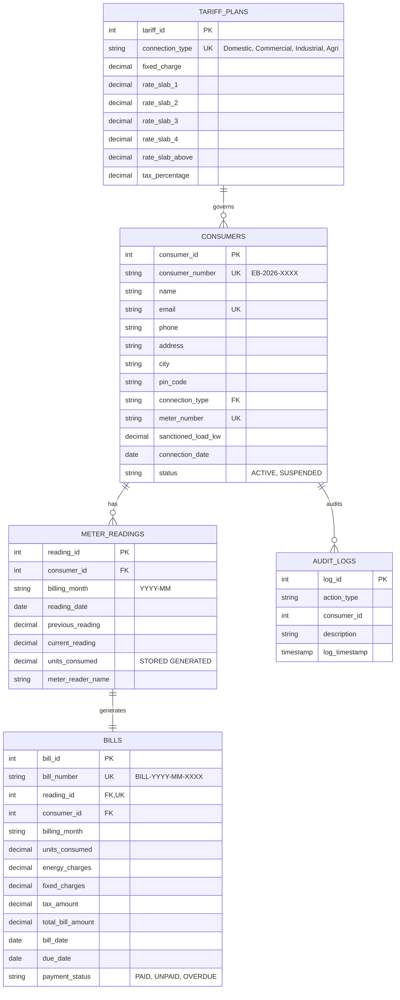

# ENTITY-RELATIONSHIP (ER) & RELATIONAL MODEL SPECIFICATION
## Scenario 14: Electricity Consumption Management and Energy Usage Analysis System

**Student:** Kanishka K | **Register No:** 732925ITR044 | **Class:** 25IT3A  
**Institution:** Velalar College of Engineering and Technology, Erode - 12  
**Course Code:** 25ITT31 – Database Management Systems (Unit 1: Database Systems and Design)

---

### 1. ENTITY-RELATIONSHIP (ER) DIAGRAM



---

### 2. CARDINALITY & STRUCTURAL CONSTRAINTS

1. **TARIFF_PLANS $\to$ CONSUMERS (1 : N):**
   * One Tariff Plan governs zero, one, or multiple Consumers.
   * Each Consumer must belong to exactly one valid Tariff Plan.
2. **CONSUMERS $\to$ METER_READINGS (1 : N):**
   * A Consumer may have multiple monthly Meter Readings over time.
   * Each Meter Reading belongs strictly to exactly one Consumer.
   * Multiplicity constraint: `UNIQUE(consumer_id, billing_month)` prevents duplicate readings in the same billing cycle.
3. **METER_READINGS $\to$ BILLS (1 : 1):**
   * Each Meter Reading produces at most one official Bill.
   * Each Bill corresponds to exactly one Meter Reading.

---

### 3. RELATIONAL MODEL MAPPING

```
1. TARIFF_PLANS (tariff_id [PK], connection_type [UK], fixed_charge, rate_slab_1, rate_slab_2, 
                 rate_slab_3, rate_slab_4, rate_slab_above, tax_percentage, description)

2. CONSUMERS (consumer_id [PK], consumer_number [UK], name, email [UK], phone, address, 
              city, pin_code, connection_type [FK -> TARIFF_PLANS.connection_type], 
              meter_number [UK], sanctioned_load_kw, connection_date, status)

3. METER_READINGS (reading_id [PK], consumer_id [FK -> CONSUMERS.consumer_id], billing_month, 
                   reading_date, previous_reading, current_reading, units_consumed, meter_reader_name)

4. BILLS (bill_id [PK], bill_number [UK], reading_id [FK -> METER_READINGS.reading_id, UK], 
          consumer_id [FK -> CONSUMERS.consumer_id], billing_month, units_consumed, 
          energy_charges, fixed_charges, tax_amount, total_bill_amount, bill_date, due_date, 
          payment_status, payment_date)

5. AUDIT_LOGS (log_id [PK], action_type, consumer_id, description, log_timestamp)
```
