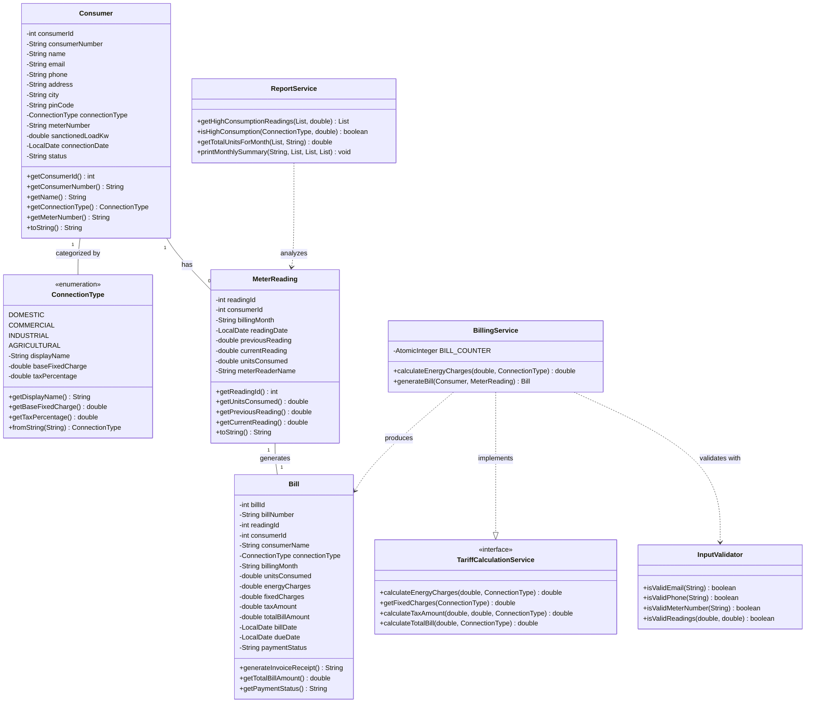

# USE CASE & CLASS DIAGRAM SPECIFICATIONS
## Scenario 14: Electricity Consumption Management and Energy Usage Analysis System

**Student:** Kanishka K | **Register No:** 732925ITR045 | **Class:** 25IT3A  
**Institution:** Velalar College of Engineering and Technology, Erode - 12  
**Course Code:** 25ITT33 – Software Engineering (Unit 2 & 3: Requirements & Design)

---

### 1. USE CASE DIAGRAM

```mermaid
graph TD
    Consumer(("Electricity Consumer"))
    Reader(("Meter Reader"))
    Admin(("EB Officer / Admin"))
    Analyst(("Data Science Analyst"))

    subgraph SystemBoundary["VoltTrack - Electricity Consumption Management System"]
        UC1["UC-1: Register New Consumer"]
        UC2["UC-2: Update Consumer Profile"]
        UC3["UC-3: Record Meter Reading"]
        UC4["UC-4: Calculate Consumption Units"]
        UC5["UC-5: Compute Bill & Apply Tariff Slabs"]
        UC6["UC-6: View & Print Invoice Receipt"]
        UC7["UC-7: Identify High-Consumption Accounts"]
        UC8["UC-8: Generate Monthly Summary Reports"]
        UC9["UC-9: Run Python EDA & Visualizations"]
    end

    Admin --> UC1
    Admin --> UC2
    Admin --> UC7
    Admin --> UC8

    Reader --> UC3
    UC3 ..> UC4 : "<<include>>"
    UC4 ..> UC5 : "<<include>>"

    Consumer --> UC6
    Admin --> UC6

    Analyst --> UC8
    Analyst --> UC9
```

---

### 2. USE CASE SPECIFICATIONS

#### Use Case: UC-3 (Record Meter Reading)
* **Actor:** Meter Reader / Field Personnel
* **Precondition:** The consumer must be actively registered with an assigned meter number.
* **Main Success Scenario:**
  1. Meter Reader selects consumer by Consumer ID / Meter Number.
  2. System retrieves and displays the previous recorded reading (e.g., 1200.0 kWh).
  3. Meter Reader inputs current meter reading (e.g., 1420.0 kWh).
  4. System verifies that current reading $\ge$ previous reading.
  5. System computes net consumption: $1420.0 - 1200.0 = 220.0\text{ kWh}$.
  6. Reading is saved to database.
* **Alternative Scenario (3a):** Current reading is less than previous reading.
  * System rejects transaction, throws `InvalidMeterReadingException`, and logs an anomaly warning.

#### Use Case: UC-5 (Compute Bill & Apply Tariff Slabs)
* **Actor:** Billing Engine / System
* **Precondition:** A valid meter reading is recorded for the billing period.
* **Main Success Scenario:**
  1. System checks consumer connection type (`Domestic`, `Commercial`, `Industrial`, `Agricultural`).
  2. System decomposes total units into respective tiered tariff slabs.
  3. System computes energy charge subtotal + fixed standing charges.
  4. System calculates government electricity duty / tax (5% for Domestic).
  5. System generates itemized bill record with unique Bill Number, Due Date, and total amount payable.

---

### 3. CLASS DIAGRAM


